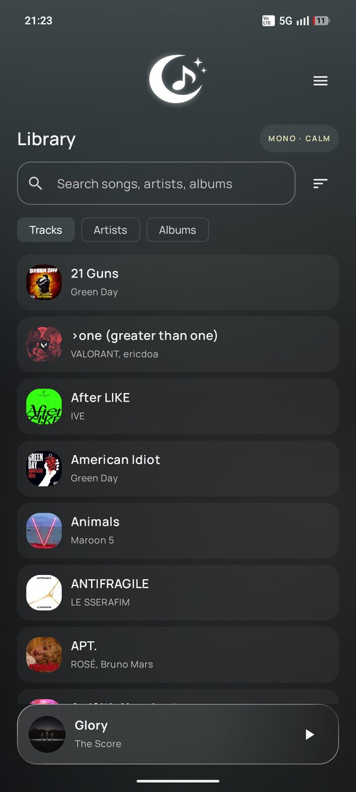
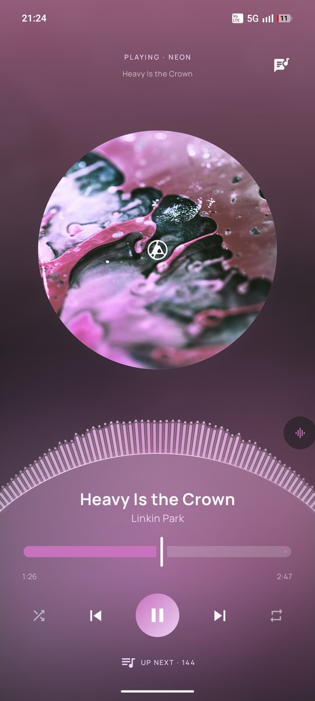
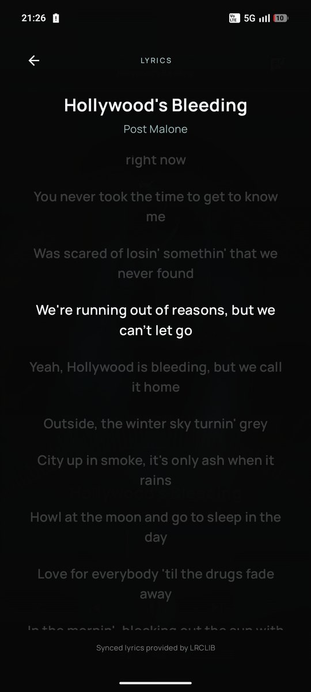
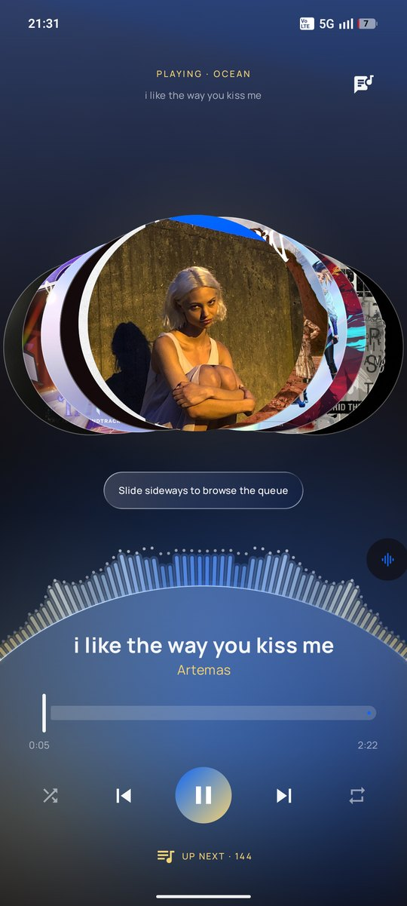
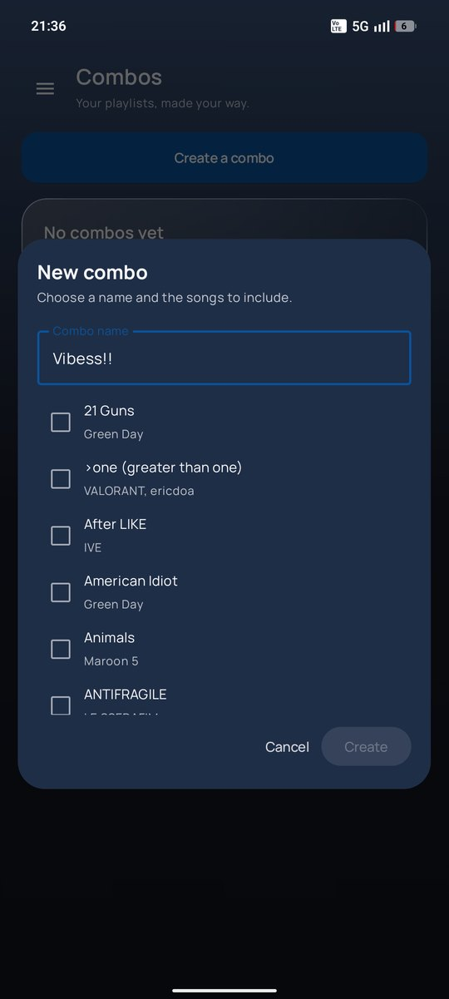
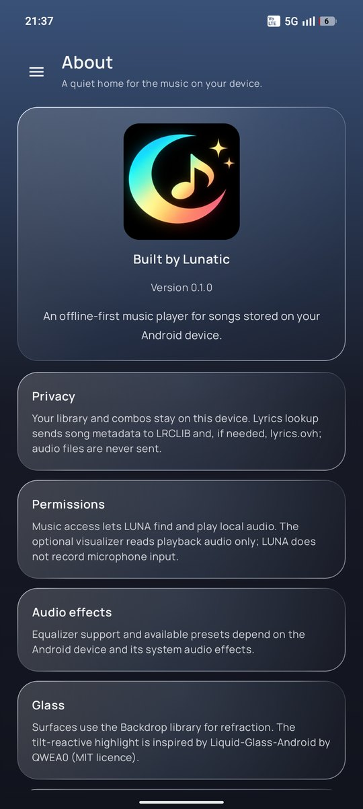

# LUNA 🌙
**Music, in another dimension.**

A native, offline-first Android music player built with Kotlin and Jetpack Compose.

## Download
Grab the latest signed APK from the [Releases page](https://github.com/Lunatic5202/Luna/releases/latest) and open it on your Android phone (Android 8.0+).

1. Download `LUNA-vX.Y.Z.apk` from the newest release.
2. Open it and allow installs from your browser or file manager if Android asks.
3. If Play Protect says "unrecognized app", tap **More details → Install anyway**. LUNA is open source and every release is signed with the same developer key, so updates install straight over the previous version.

Want automatic updates? Add `https://github.com/Lunatic5202/Luna` to [Obtainium](https://obtainium.imranr.dev/) and it will install each new release for you.

On first launch LUNA asks for your music library (required), the microphone (so the visualizer can react to the music; LUNA never records your voice) and notifications (playback controls on the lock screen). Only the library is required.

## Screenshots

  
  
  

  
  
  

## Features
- Local audio discovery through MediaStore (scanned off the UI thread)
- Android audio permission flow
- Media3 ExoPlayer owned by a dedicated `MediaSessionService`
- MediaController connection from the Compose Activity
- System media session integration for playback notification, lock-screen and headset controls
- Track metadata and artwork URI supplied to the media session
- Album-art palette extraction with bounded thumbnail decoding
- Bounded LRU palette cache with synchronized extraction
- Animated adaptive colour transitions and semantic Material 3 colours
- Haze-backed frosted-glass surfaces with album-tinted blur, translucent fills, noise, and reflective edge highlights
- Compose liquid-glass surfaces for the mini-player and fullscreen controls, with adaptive album tint and a blur fallback
- Blurred album-art ambience behind the Now Playing screen
- Animated library/player screen transitions
- Full-screen Now Playing UI with seek progress, duration, and playback controls
- Full-screen lyrics view with artist metadata, synced-lyrics support, and a blurred animated artwork backdrop
- Lyrics results cached on-device with expiry, while temporary lookup failures remain retryable
- Library search across track, artist, and album metadata; Tracks, Artists, and Albums views with title, artist, and album sorting
- Live audio visualizer around the player dome: real frequency data when the microphone permission is granted, a synthetic beat otherwise
- Vibes: every track gets a mood tag from its artwork (EMBER, OCEAN, NEON, MONO... with CALM, GROOVY or ENERGETIC) and a slow drifting aurora behind the library in the album's colours
- Animated startup: a black splash, then the moon blooms in with a sweeping ring and wordmark
- Session queue sheet with direct track selection
- Shuffle and repeat-off / repeat-all / repeat-one controls
- Device-backed equalizer with vertical band sliders and a live response curve
- Equalizer profiles: 14 built-in presets, your own saved custom profiles (save, update, rename, delete) and the device's own presets
- Tilt-reactive glass highlight: surfaces catch a specular rim that follows the device's gravity sensor
- Hold the fullscreen artwork to peek the previous and next tracks, slide to one and release to play it
- Local playlist combos, a swipe-open navigation drawer, and an About page

See [RELEASE_CHECKLIST.md](RELEASE_CHECKLIST.md) for the device and release review steps.

## Build
- Android Studio with Android SDK 36
- JDK 17
- Run `./gradlew :app:assembleDebug` (Windows: `gradlew.bat :app:assembleDebug`). The checked-in Gradle wrapper pins Gradle 8.13 and verifies its SHA-256 checksum.
- Build the optimized release with `./gradlew :app:assembleRelease` (Windows: `gradlew.bat :app:assembleRelease`); R8 and resource shrinking are enabled. Without the signing environment variables below the resulting APK is unsigned.
- Open the repository as a Gradle project, sync dependencies, then run the `app` configuration on a device or emulator.
- GitHub Actions uses the same wrapper command on pushes and pull requests to `main`.

### Signing and releases
Release builds read their key from environment variables: `LUNA_KEYSTORE_PATH`, `LUNA_KEYSTORE_PASSWORD`, `LUNA_KEY_ALIAS` and `LUNA_KEY_PASSWORD`. In GitHub Actions these come from repository secrets (`LUNA_KEYSTORE_BASE64`, `LUNA_KEYSTORE_PASSWORD`, `LUNA_KEY_ALIAS`, `LUNA_KEY_PASSWORD`). Keep a private backup of the keystore: losing it means updates can no longer install over existing installs.

To publish a release, create a tag such as `v0.2.0` (from the GitHub Releases page or `git tag v0.2.0 && git push origin v0.2.0`). The **Release** workflow builds the signed APK, checks its signature and attaches `LUNA-v0.2.0.apk` to a GitHub release. The tag sets `versionName`, and the workflow run number sets `versionCode`.

First build requires internet for Gradle dependencies. Lyrics are looked up on demand through LRCLIB, with lyrics.ovh as a fallback, using track metadata only; music playback and library scanning stay on device.

## Architecture notes
- `MainActivity` owns UI state and connects to `LunaPlaybackService` through a Media3 `MediaController`. It does not own or release the player.
- `LunaPlaybackService` owns the ExoPlayer and MediaSession independently of the Activity lifecycle. Media3 supplies the system media notification and session controls while playback is active.
- `MusicRepository` queries MediaStore on `Dispatchers.IO`; the Activity collects the result asynchronously.
- `LunaThemeEngine` extracts and caches album-art palettes. A request token prevents an older artwork decode from replacing the palette for a newer track.
- `LunaGlassSurface` uses the Compose Backdrop liquid-glass effect over a captured screen background; custom dome geometry and older Android releases use the frosted blur fallback.
- Combos are stored locally in app preferences and refer to MediaStore track IDs; deleting a source file can make a saved combo shorter or unplayable.
- The equalizer attaches Android's `Equalizer` audio effect to ExoPlayer's audio session. Support and the number of bands vary by device; LUNA does not record microphone input.
- Built-in and custom equalizer profiles are stored as (frequency, level) points and interpolated onto the device's own band centres, so a profile keeps its shape on devices with a different band count. Device presets are applied through the system effect.
- `LunaGlassLight` registers the gravity sensor only while the activity is resumed and stays static when animations are disabled or no sensor exists. The idea comes from [QWEA0/Liquid-Glass-Android](https://github.com/QWEA0/Liquid-Glass-Android) (MIT); that library targets the View system, so only the concept is ported to Compose, on top of the existing Backdrop-based glass.
- `PlaybackVisualizer` reads the player's audio session with Android's `Visualizer` (needs the microphone permission; it only sees this player's output) and falls back to a synthetic beat when unavailable.
- `LunaAurora` draws the library's drifting colour wash entirely in the draw phase, so it never triggers recomposition.
- MediaStore album-art URIs may be missing on some devices; LUNA falls back to a default palette.

## Roadmap
- [x] MediaSessionService and MediaController foundation
- [x] System media-session metadata and playback controls
- [x] Asynchronous local library scan
- [x] Bounded album palette extraction/cache
- [x] Full player screen and artwork ambience
- [x] Seek bar, progress and duration
- [x] Animated library/player transitions
- [x] Search, album and artist views (folder view still to do)
- [x] Playback queue, shuffle and repeat modes
- [x] User-created playlist combos
- [ ] Persistent queue editing
- [x] Haze-backed backdrop blur and adaptive glass treatment
- [ ] Refraction-driven glass highlights
- [x] Audio-reactive visualizer
- [ ] Sleep timer
- [x] System equalizer controls
- [x] Signed release builds published to GitHub Releases
- [ ] Instrumentation tests, device validation and release polish

## Stack
Kotlin · Jetpack Compose · Material 3 · AndroidX Media3 · AndroidX Palette · Haze

