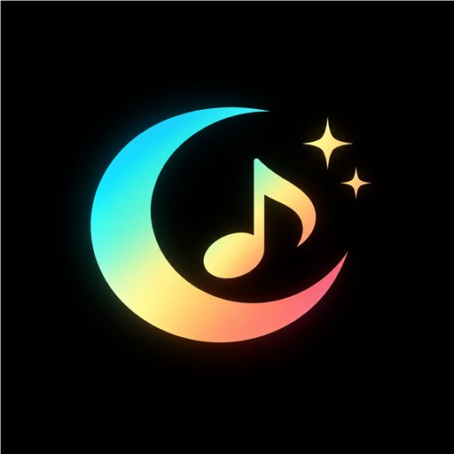

# LUNA 

**Music, in another dimension.**

*A glassy, colour-shifting, offline-first music player for the songs already on your Android phone.*

[**Download**](#-download) &nbsp;•&nbsp; [**Screenshots**](#-showcase) &nbsp;•&nbsp; [**Features**](#-features) &nbsp;•&nbsp; [**Build**](#-build-from-source) &nbsp;•&nbsp; [**Under the hood**](#-under-the-hood)

 

---

## Showcase

<table align="center">
 <tr>
 <td align="center"> <b>Library</b> mood tag + aurora</td>
 <td align="center"> <b>Now playing</b> live visualizer dome</td>
 <td align="center"> <b>Synced lyrics</b> line by line</td>
 </tr>
 <tr>
 <td align="center"> <b>CD stack</b> hold the art to browse</td>
 <td align="center"> <b>Combos</b> your playlists</td>
 <td align="center"> <b>About</b> liquid glass cards</td>
 </tr>
</table>

---

## Features

<table>
 <tr>
 <td valign="top" width="33%">
 <h3> Playback</h3>
 Background playback with notification and lock-screen controls, headset buttons, shuffle, repeat (off / all / one), a reorderable queue, auto-pause when headphones disconnect, and bad files skipped instead of stalling.
 </td>
 <td valign="top" width="33%">
 <h3> CD stack</h3>
 Press and hold the artwork and your previous and upcoming tracks fan out like a stack of CDs. Slide to one, let go, and it plays.
 </td>
 <td valign="top" width="33%">
 <h3> Vibes</h3>
 Every track gets a mood from its album art (EMBER, OCEAN, NEON, MONO&hellip;) with CALM, GROOVY or ENERGETIC energy. The whole app and a slow aurora behind your library shift colour with the song.
 </td>
 </tr>
 <tr>
 <td valign="top">
 <h3> Visualizer</h3>
 A spectrum ring around the player dome dances to your music in real time. It only reads LUNA's own audio, and falls back to a synthetic beat if you skip the microphone permission.
 </td>
 <td valign="top">
 <h3> Lyrics</h3>
 Full-screen synced lyrics that follow the song, cached on your device with smart expiry so repeat views are instant.
 </td>
 <td valign="top">
 <h3> Equalizer</h3>
 Vertical band sliders with a live response curve, 14 built-in presets, your own saved profiles and your device's own presets.
 </td>
 </tr>
 <tr>
 <td valign="top">
 <h3> Library</h3>
 Fast MediaStore scan, search across title, artist and album, Tracks / Artists / Albums views, sorting, and Combos: playlists made your way.
 </td>
 <td valign="top">
 <h3> Liquid glass</h3>
 Refracting, frosted glass surfaces tinted by the album art, with a specular highlight that follows your phone's tilt.
 </td>
 <td valign="top">
 <h3> Startup</h3>
 A black splash, then the moon blooms in, a gradient ring sweeps around it and LUNA dissolves into your library.
 </td>
 </tr>
</table>

---

## Download

1. Download `LUNA-vX.Y.Z.apk` from the [latest release](https://github.com/Lunatic5202/Luna/releases/latest) on your Android phone (Android 8.0+).
2. Open it and allow installs from your browser or file manager if Android asks.
3. If Play Protect says *"unrecognized app"*, tap **More details → Install anyway**. LUNA is open source and every release is signed with the same developer key, so updates install straight over the previous version.

> [!TIP]
> Want automatic updates? Add `https://github.com/Lunatic5202/Luna` to [Obtainium](https://obtainium.imranr.dev/) and it installs each new release for you.

**Permissions on first launch**

| Permission | Why | Required |
| --- | --- | :---: |
| Music library | Find and play the audio stored on your phone | |
| Microphone | Lets the visualizer react to the music. It only reads LUNA's own audio; your voice is never recorded | optional |
| Notifications | Playback controls in the notification shade and on the lock screen | optional |

**Privacy:** your library and combos stay on your device. Lyrics lookups send only the song title, artist and album to [LRCLIB](https://lrclib.net) (and lyrics.ovh as a fallback). Audio files are never uploaded.

---

## Build from source

- Android Studio with Android SDK 36
- JDK 17
- Run `./gradlew :app:assembleDebug` (Windows: `gradlew.bat :app:assembleDebug`). The checked-in Gradle wrapper pins Gradle 8.13 and verifies its SHA-256 checksum.
- Build the optimized release with `./gradlew :app:assembleRelease` (Windows: `gradlew.bat :app:assembleRelease`); R8 and resource shrinking are enabled. Without the signing environment variables below the resulting APK is unsigned.
- Open the repository as a Gradle project, sync dependencies, then run the `app` configuration on a device or emulator.
- GitHub Actions uses the same wrapper command on pushes and pull requests to `main`.

### Signing and releases
Release builds read their key from environment variables: `LUNA_KEYSTORE_PATH`, `LUNA_KEYSTORE_PASSWORD`, `LUNA_KEY_ALIAS` and `LUNA_KEY_PASSWORD`. In GitHub Actions these come from repository secrets (`LUNA_KEYSTORE_BASE64`, `LUNA_KEYSTORE_PASSWORD`, `LUNA_KEY_ALIAS`, `LUNA_KEY_PASSWORD`). Keep a private backup of the keystore: losing it means updates can no longer install over existing installs.

To publish a release, create a tag such as `v0.2.0` (from the GitHub Releases page or `git tag v0.2.0 && git push origin v0.2.0`). The **Release** workflow builds the signed APK, checks its signature and attaches `LUNA-v0.2.0.apk` to a GitHub release. The tag sets `versionName`, and the workflow run number sets `versionCode`.

First build requires internet for Gradle dependencies. Lyrics are looked up on demand through LRCLIB, with lyrics.ovh as a fallback, using track metadata only; music playback and library scanning stay on device.

---

## Under the hood

<b>Architecture notes</b>

 

- `MainActivity` owns UI state and connects to `LunaPlaybackService` through a Media3 `MediaController`. It does not own or release the player.
- `LunaPlaybackService` owns the ExoPlayer and MediaSession independently of the Activity lifecycle. Media3 supplies the system media notification and session controls while playback is active.
- `MusicRepository` queries MediaStore on `Dispatchers.IO`; the Activity collects the result asynchronously.
- `LunaThemeEngine` extracts and caches album-art palettes. A request token prevents an older artwork decode from replacing the palette for a newer track.
- `LunaGlassSurface` uses the Compose Backdrop liquid-glass effect over a captured screen background; custom dome geometry and older Android releases use the frosted blur fallback.
- Combos are stored locally in app preferences and refer to MediaStore track IDs; deleting a source file can make a saved combo shorter or unplayable.
- The equalizer attaches Android's `Equalizer` audio effect to ExoPlayer's audio session. Support and the number of bands vary by device; LUNA does not record microphone input.
- Built-in and custom equalizer profiles are stored as (frequency, level) points and interpolated onto the device's own band centres, so a profile keeps its shape on devices with a different band count. Device presets are applied through the system effect.
- `LunaGlassLight` registers the gravity sensor only while the activity is resumed and stays static when animations are disabled or no sensor exists. The idea comes from [QWEA0/Liquid-Glass-Android](https://github.com/QWEA0/Liquid-Glass-Android) (MIT); that library targets the View system, so only the concept is ported to Compose, on top of the existing Backdrop-based glass.
- `PlaybackVisualizer` reads the player's audio session with Android's `Visualizer` (needs the microphone permission; it only sees this player's output) and falls back to a synthetic beat when unavailable.
- `LunaAurora` draws the library's drifting colour wash entirely in the draw phase, so it never triggers recomposition.
- MediaStore album-art URIs may be missing on some devices; LUNA falls back to a default palette.

<b>Roadmap</b>

 

- [x] MediaSessionService and MediaController foundation
- [x] System media-session metadata and playback controls
- [x] Asynchronous local library scan
- [x] Bounded album palette extraction/cache
- [x] Full player screen and artwork ambience
- [x] Seek bar, progress and duration
- [x] Animated library/player transitions
- [x] Search, album and artist views (folder view still to do)
- [x] Playback queue, shuffle and repeat modes
- [x] User-created playlist combos
- [ ] Persistent queue editing
- [x] Haze-backed backdrop blur and adaptive glass treatment
- [ ] Refraction-driven glass highlights
- [x] Audio-reactive visualizer
- [ ] Sleep timer
- [x] System equalizer controls
- [x] Signed release builds published to GitHub Releases
- [ ] Instrumentation tests, device validation and release polish

**Stack:** Kotlin · Jetpack Compose · Material 3 · AndroidX Media3 · AndroidX Palette · Haze · Backdrop (liquid glass)

---

## Credits

- Liquid-glass surfaces use the Compose Backdrop library; the tilt-reactive highlight is inspired by [QWEA0/Liquid-Glass-Android](https://github.com/QWEA0/Liquid-Glass-Android) (MIT).
- Lyrics from [LRCLIB](https://lrclib.net) and [lyrics.ovh](https://lyrics.ovh).
- Startup wordmark set in [Josefin Sans](https://fonts.google.com/specimen/Josefin+Sans) (SIL Open Font License); app text in [Manrope](https://fonts.google.com/specimen/Manrope).

Built with by <b>Lunatic</b> &nbsp;·&nbsp; If LUNA makes your music nicer, a means a lot.

## Playback and visualizer clarification

The visualizer is intended to react to LUNA's own playback session, not to record ambient microphone audio. Android may still require the platform's audio-visualizer permission path for the effect API; explain that purpose before requesting it. Keep the visualizer optional through settings and preserve local-only music scanning and playback.

Album-art palette extraction and artwork loading are performance-sensitive parts of the player. When changing them, test fast library scrolling and the mini-player-to-full-player transition on a real device, not only an emulator screenshot. Do not claim a performance fix without measuring or reproducing the affected transition.
